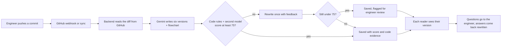

# Rosetta

**Every commit, explained for whoever's reading.**

Engineers push code; managers, clients and the CMO need to know what it means for them. Rosetta reads each GitHub commit and explains it six ways, from a precise engineering summary to a plain-language note for a CMO, with a before-and-after flowchart, a worked example, and a check of how well the explanation matches the code. Questions go straight back to the engineer who wrote it, and answers come back rewritten for the person who asked.

Built by Team CodeCrunchers.

---

## The six readers

Your role is your reading level. Everyone sees the same change, written for them:

| Reader | Gets |
| --- | --- |
| Engineer | Function names, files, values and edge cases |
| Senior developer | A quick technical summary: patterns and risks |
| Intern | How and why, with the file worth reading first |
| Manager | Impact, risk, and whether plans change. No code |
| Client | What their money paid for, in business terms |
| CMO | Customers, campaigns and growth. Zero technical words |

Manager, client and CMO can also read everything in **Hinglish**.

## What it does

**Explanations people can trust**
- Explains any public commit or pull request: a summary, an everyday analogy, the impact, and a detailed flowchart (decisions, data, outcomes, before vs after) with a step-by-step worked example.
- Every explanation is checked against the real diff: plain code rules (no jargon for non-technical readers, no names that aren't in the change) plus a second AI model that scores it out of 100. Below 75 it's rewritten once with the problems as feedback; still low, it's flagged **Needs engineer review**.
- Select any box in the flowchart to see the lines of code behind it.
- The engineer who made the change reviews and edits it before it counts as reviewed, previewing all six versions.
- **Check accuracy** re-runs the checks step by step; the same change always gets the same score.

**A workspace that follows your org chart**
- A CMO or manager creates the workspace and adds people: CMO → managers → engineers, senior developers and interns; clients sit under their manager.
- Each person sees only what their role allows: engineers their own work, managers their team, the CMO everything.
- New commits arrive by themselves from watched repositories (GitHub webhook, or a sync every few minutes).

**Conversations across roles**
- **Ask Why** on any step: answered from the code, or sent to the engineer with a technical version of the question.
- Questions, replies and engineers' comments are rewritten once for every reader. A rewrite that adds a number the original didn't have is thrown away.
- Readers can report a possible mistake straight to the author.

**Staying in the loop**
- Notification bell, plus email (invites, questions, replies, reports, password resets).
- **This week**: a one-page weekly digest, printable as a PDF, and a Monday email to the owner with every engineer's changes and flowcharts.
- Feed search in your own words, with date, risk and repository filters.

**Trust and privacy**
- Privacy Policy, Terms, Cookie Policy, Refund Policy, a full "what data we collect" table, contact and licences pages.
- Consent at signup, a storage banner with equal choices, **Download my data** and **Delete my account** in the profile.
- Keyboard-friendly, labelled forms; WCAG 2.2 AA contrast in both themes; tested with axe.

## How it works



- **Frontend** (`frontend/`): Next.js 16, React 19, Tailwind CSS 4, Mermaid for flowcharts, Base UI, Motion. Talks only to the backend.
- **Backend** (`backend/`): an API-only Next.js 16 app. Every key lives here. Gemini explains; Groq (or OpenRouter) checks explanations, answers Ask Why and rewrites messages, and steps in when Gemini is unavailable. Data is stored in Firestore, or in a local JSON file when Firebase isn't configured.
- Full diffs aren't stored: only the explanation and a few lines behind each flowchart step.

## Quick start

You need Node.js 22 or newer. No keys are needed to try it: three sample commits and a sample team work offline.

```bash
git clone https://github.com/vaibhav025/Rosetta-NSUT.git
cd Rosetta-NSUT

# Terminal 1: the API on http://localhost:4000
cd backend
npm install
cp .env.example .env.local
npm run dev

# Terminal 2: the website on http://localhost:3000
cd frontend
npm install
npm run dev
```

Open http://localhost:3000, create a workspace as a CMO or manager, then press **Add a sample team**. Every sample person can log in with the email and the random password shown once in the result, so you can see each role's view.

## Configuration

Add keys to `backend/.env.local` as you need them:

| Key | Unlocks |
| --- | --- |
| `GEMINI_API_KEY` | Explaining any commit |
| `FALLBACK_API_KEY` | Groq or OpenRouter: checking explanations, Ask Why, rewriting messages, backup for Gemini |
| `GITHUB_TOKEN` | More than 60 GitHub requests an hour, repository sync |
| `FIREBASE_PROJECT_ID` · `FIREBASE_CLIENT_EMAIL` · `FIREBASE_PRIVATE_KEY` | Firestore instead of the local file (required in production) |
| `SESSION_SECRET` | Signs login tokens (required in production) |
| `SMTP_USER` · `SMTP_PASS` | Email, Gmail by default |
| `ALLOWED_ORIGINS` · `APP_URL` | The frontend's address, for CORS and email links |
| `CRON_SECRET` | The Monday weekly report email |

The frontend reads `NEXT_PUBLIC_API_BASE` (defaults to `http://localhost:4000`). Every option is documented in [`backend/.env.example`](backend/.env.example) and [`frontend/.env.example`](frontend/.env.example).

## Commands

| Where | Command | Does |
| --- | --- | --- |
| backend | `npm run build && npm test` | API tests on an isolated server (throwaway store, no AI, no email), plus unit tests for the verifier and message rewriting |
| backend | `npm run demo -- <api-url>` | Creates a ready-to-show workspace with every role and prints the logins |
| backend | `npm run migrate` | Copies local data into Firestore (dry run first, `-- --write` to copy) |
| backend | `npm run pitch:judge` | Re-scores the pitch commit's explanation with the real judge model |
| frontend | `npm run licenses` | Regenerates the open-source licence list shown on `/licenses` |
| both | `npm run typecheck` | TypeScript checks |

## Demo

There is a fixed pitch commit that always explains the same way, with no GitHub or AI calls, so a live demo can't fail:

```
https://github.com/vaibhav025/Rosetta-NSUT/commit/ca08ab4f0a3ecce71292c0be57ccfbd33ff6024e
```

Paste it as an engineer, then log in as their manager to see it arrive, ask a question, and read the engineer's answer in manager words. The full script, including the exact question and answer, is in [DEPLOY.md](DEPLOY.md#the-pitch-commit).

## Deploying

Two Vercel projects (`backend/` and `frontend/`), Firestore, and an optional GitHub webhook. Step by step in [DEPLOY.md](DEPLOY.md).

## Project layout

```
backend/
  src/app/api/       API routes (auth, team, feed, explain, cards, tickets, digest, ...)
  src/lib/           AI tasks and verifier, GitHub, store, email, roles and visibility
  src/lib/demo/      Sample commits, sample team, the pitch commit and its script
  test/              API and unit tests (npm test)
  scripts/           demo, migrate, pitch:judge
frontend/
  src/app/           Pages: landing, auth, the app (/app/...), legal pages
  src/components/    Flowchart, card view, Ask Why, feeds, dashboards, consent, ...
  src/lib/           API client, session, roles, legal details, consent
DEPLOY.md            Deploying, and the pitch walkthrough
```

More detail: [backend/README.md](backend/README.md) (every API route, how data flows, known limits) and [frontend/README.md](frontend/README.md) (every screen and where things are).

## Good to know

- **AI and your code.** Explaining a change sends its diff to the AI provider. Rosetta currently uses Gemini's free tier, under which Google may use submitted content to improve its products. Use a paid tier before connecting private or confidential code. Details in the Privacy Policy (`/privacy`) and [backend/README.md](backend/README.md#before-real-customers-ai-providers-and-their-data).
- **AI can be wrong.** Every explanation is scored and reviewed by its engineer, but check anything important.
- **Legal pages are templates.** Business details in `frontend/src/lib/legal.ts` are placeholders to fill in, and the pages need review by a lawyer before launch.
- **Free tiers.** Gemini's free tier allows about 20 explanations a day; leads can see today's usage on the Organisation page.

## Licence

No licence has been chosen for this project yet. Open-source dependencies and fonts are listed with their licences on the `/licenses` page.
